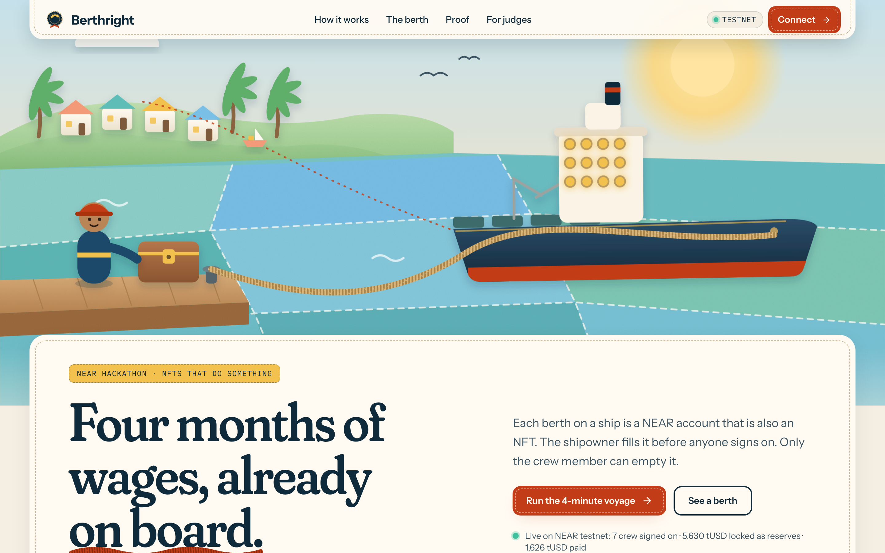
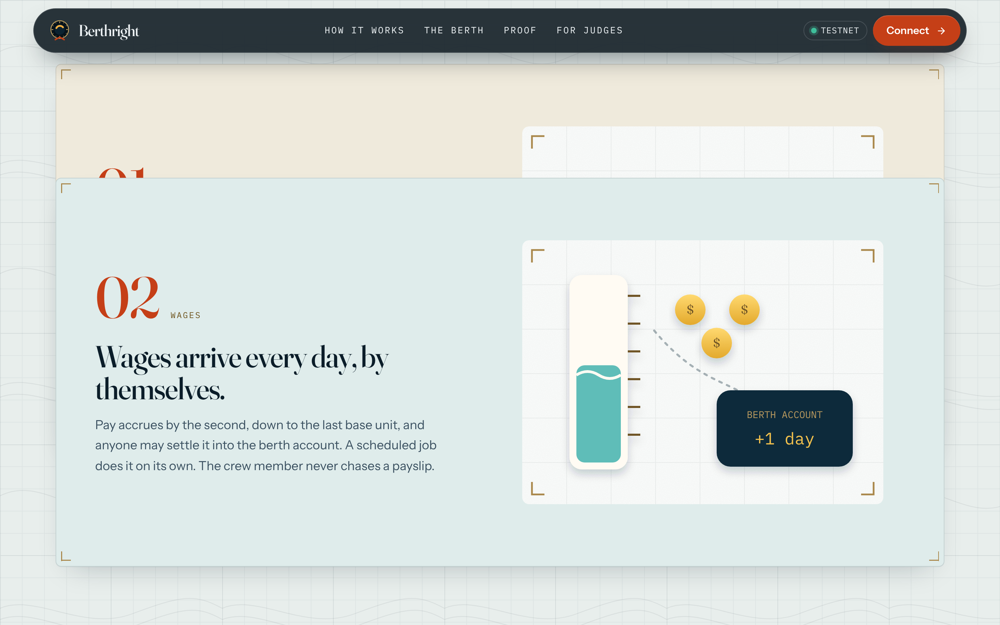
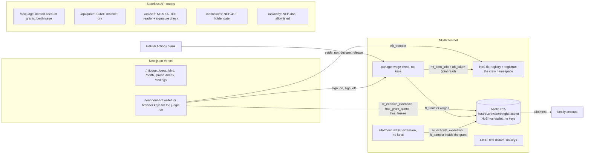
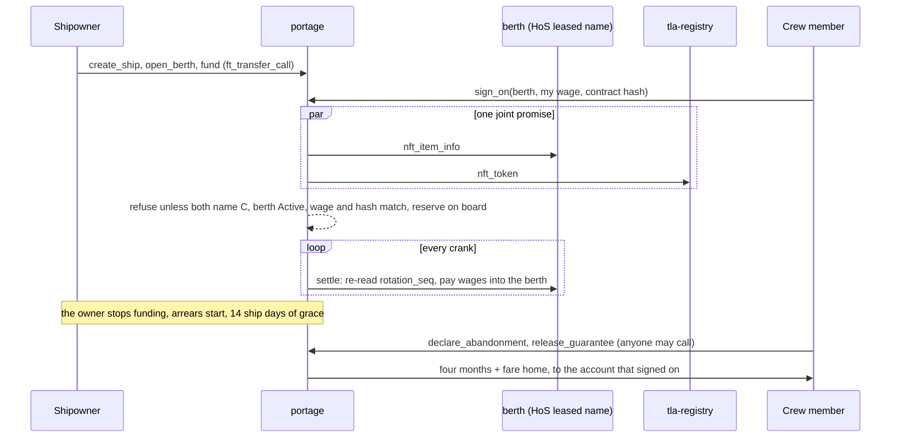
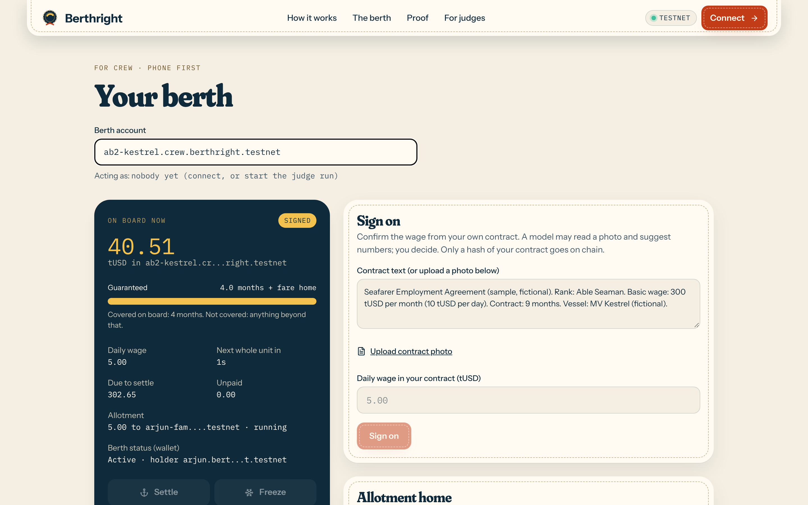
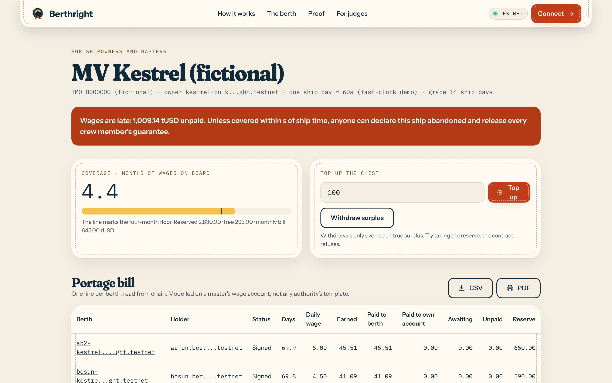
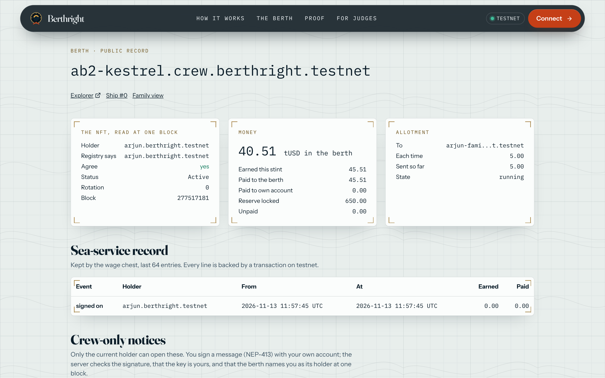
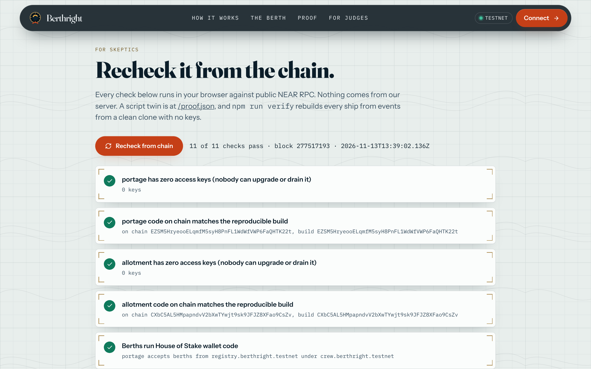

<p align="center">
  
</p>

<h1 align="center">Berthright</h1>

<p align="center">
  <b>Four months of crew wages on board, without an insurance claim.</b><br>
  Each berth on a ship is a NEAR account that is also an NFT. The shipowner fills it before anyone signs on. Only the crew member can empty it.
</p>

<p align="center">
  <a href="https://berthright-app.vercel.app"><b>Live app</b></a> &nbsp;·&nbsp;
  <a href="https://berthright-app.vercel.app/judge"><b>Four-minute voyage (no wallet)</b></a> &nbsp;·&nbsp;
  <a href="https://berthright-app.vercel.app/berths"><b>Berth register (NFTs)</b></a> &nbsp;·&nbsp;
  <a href="https://berthright-app.vercel.app/proof"><b>Proof from chain</b></a> &nbsp;·&nbsp;
  <a href="docs/EVIDENCE.md"><b>Evidence</b></a> &nbsp;·&nbsp;
  Video: linked at submission
</p>

<p align="center">
  <a href="https://github.com/0xkinno/berthright/actions/workflows/ci.yml"></a>
  
  
</p>

<p align="center"></p>

## At a glance

| | |
|---|---|
| **Who it is for** | Seafarers like Arjun, able seaman, day 74 at anchor, two months unpaid |
| **What it does** | Locks four months of each berth's wages and the fare home *before* sign-on; pays wages daily into the berth; sends the allotment home through the berth's own spend grant; releases the guarantee to each crew member's own account if the owner stops paying |
| **Why NEAR** | The berth *is* a House of Stake Top Level Account: a named, keyless account that is also an NEP-171 token, with a native spend grant. Berthright is built on their audited contracts, deployed unmodified |
| **Proven on real data** | 138 real abandonment cases (1,632 seafarers, 2023 to 2025): **57.8%** of owed crew-months would have been on board on day one. Today: 0% |
| **Proven on chain** | A full voyage through the UI on testnet, 8 of 8 checks, 22 transactions; 10 refusals recorded as real transactions; `verify.ts` rebuilds every ship from events (22 of 22 checks, 13 Nov) and fails on tampering; one real ITF case (SELIN) run end to end on testnet; **one voyage on mainnet in real USDC**, funded from Base through NEAR Intents |
| **Tracks** | NFTs That Do Something (`nfts`) · Real-World Money (`realworld`) · Open Innovation (`open`) |
| **Built with** | House of Stake TLA (`hos-wallet`, `tla-registry`, `registrar`, `hos-extension`, `mpc-recovery`) · NEP-171/141/145/148/297/413/366 · NEAR Intents 1Click · NEAR AI Cloud (TEE) |

### See it happen on testnet

| What happens | Call | Transaction |
|---|---|---|
| Sign-on refused: four months not on board yet | `portage.sign_on` | [refused, `E_RESERVE_NOT_ON_BOARD`](https://testnet.nearblocks.io/txns/DhbeoSWqEuXtYQTnTbuTYSAdjKK41BFNitNNWhDpVUKp) |
| Crew member signs on with the wage from their own contract | `portage.sign_on` | [signed on](https://testnet.nearblocks.io/txns/5KPmrKPma1XguF7wb3wpR41CD2iSwTkpbxVDSgFrvDD8) |
| Wages land in the berth account | `portage.settle` | [settled](https://testnet.nearblocks.io/txns/8N3qzuqeeCjqPVhSKxpZwHh7iDUwkw3im6T6PeBZwcAW) |
| Allotment home, fenced by the berth's spend grant | `allotment.run` → `w_execute_extension` | [sent](https://testnet.nearblocks.io/txns/AX41JhypxqEH9sYyVEu3HK9DAw4EDBrT1LBfsEEwMdE7) |
| Owner stopped paying; abandonment declared after the grace | `portage.declare_abandonment` | [declared](https://testnet.nearblocks.io/txns/9Fec6TWX2NTn9DwQRHfQvPYP73a7HtMRQENaeBV3vrdd) |
| Four months and the fare home released to the crew member's own account | `portage.release_guarantee` | [released](https://testnet.nearblocks.io/txns/5rcL5UQvcCYjybGKmMWMHwFnp5pqtohmmGiG4mGq1EWo) |

All six come from one unattended browser run of `/judge` (`e2e/judge.mjs`); the full list of 22 is in [EVIDENCE.md](docs/EVIDENCE.md).


### On mainnet, in real USDC

The same chest also ran one voyage on NEAR mainnet at demo scale (0.01 USDC a ship day, a ten-second ship day), funded from Base through NEAR Intents and paying a real House of Stake berth. `/proof` rechecks it live: the chest holds zero keys, its code hash equals the reproducible build, `berthright.seafarer` agrees with `registry.hos`, and the berth reads Released.

| What happens | Call | Transaction |
|---|---|---|
| Funded from Base through NEAR Intents: 3 + 30 USDC to native NEAR | 1Click, Base to NEAR | [4y788AYa](https://nearblocks.io/txns/4y788AYacunMRPGPNvxoMHxPc5TARZptM36tYATEw4HB), [3rQ97Cka](https://nearblocks.io/txns/3rQ97Cka9PLCQbtjEWVovQJFqTT5maqn4qmxW8Ls2Hq6) |
| Wage chest deployed, same build as testnet, wired to `registry.hos` / `seafarer` | deploy, `new` | [deploy](https://nearblocks.io/txns/8pLiho8zgsCJcaFzbJmxUoQFtDLSaAPfhLwzatqjCXud), [new](https://nearblocks.io/txns/HA3pLQxKiPwQAr4t8N3uiU2idV358U1dSyreBKy6SDww) |
| Chest sealed before any money moved: its only key deleted | DeleteKey | [sealed](https://nearblocks.io/txns/G24fvocRP3zPkPYqyd5BJRX1ujuHLiW9sGdHadjb2Jhi) |
| Berth rented by the crew member: `berthright.seafarer`, a real House of Stake leased name | `registry.hos.rent_sub_account` | [rented](https://nearblocks.io/txns/5HoXEQAWZKdbfgMpbaV5doAqRUuGWWmCno7XMBMUXmWj) |
| Shipowner buys USDC with NEAR through NEAR Intents | 1Click, NEAR to USDC | [deposit](https://nearblocks.io/txns/GLz84ppoxf4MvvK4eGHSbWkyTxd9i9dgybfieySPMmYF) |
| Sign-on refused: four months not on board | `sign_on` | [refused](https://nearblocks.io/txns/CirKSZyaF8jNTyZnTwuM2PaUJBvfhSSmAcMBkn6H1xt2) |
| Four months plus the fare home locked, 1.30 USDC | `ft_transfer_call` | [locked](https://nearblocks.io/txns/GWu78aFqBsYqPk2USz8w9JuCHfNs6r3WVo3BrWNHUxc7) |
| Crew member signs on | `sign_on` | [signed on](https://nearblocks.io/txns/DmcGc9rXtLNYwJCaEpGsu2mSd4bPd4FEPTvtBr9VToc5) |
| Early abandonment refused | `declare_abandonment` | [refused](https://nearblocks.io/txns/4iy4LBvqkZRadWBqrk1MFuaSnAFpMrsrTFChgVpNzWxs) |
| Abandonment declared after 14 ship days unpaid | `declare_abandonment` | [declared](https://nearblocks.io/txns/3HFc5pcZT28gMgPYzRwWWQ1gHStrbs6KVRUcGhkQsfa1) |
| Guarantee released: 1.30 USDC to `crew.berthright.near` | `release_guarantee` | [released](https://nearblocks.io/txns/2N6agBQbjHGd8pMErN8Nqjc2KDXezMVVxP9G8utRDhq5) |

Leftovers went back to the funder's Base wallet through NEAR Intents: 1.943693 and 11.490548 USDC. Every hash is in [data/mainnet.json](data/mainnet.json).

---

## Day 74 at anchor

It is 21:40 ship&apos;s time off Khor Fakkan, UAE. Arjun, 31, an able seaman from Kochi, has not been paid for two months. Under the Maritime Labour Convention that already counts as abandonment. His sister&apos;s college fee is due on Friday. The ship&apos;s insurer is meant to cover up to four months of wages, but first he has to find out who the insurer is, file a claim from a ship with patchy internet, and wait. One insurer took **8 months** to accept a valid claim.

| What is true | Source |
|---|---|
| **6,223** seafarers were abandoned on **410** ships in 2025, owed **US$25.8M**; the ITF recovered US$16.5M. The sixth record year in a row for vessels | [ITF, 2025 data](https://www.itfseafarers.org/en/news/seafarer-abandonment-crisis-thousands-left-behind-shippings-worst-year-record) |
| Indian seafarers were the most abandoned group, **1,125**, two years running; the Middle East was the worst region | same |
| Two months of unpaid wages is abandonment; the mandatory financial security covers up to four months plus repatriation | MLC 2006 as amended, Standard A2.5.2, paras 2(c) and 9 |
| An insurer took eight months to accept liability and pay | [ITF to the IMO Legal Committee, LEG 105/4/3](https://www.itfglobal.org/sites/default/files/node/resources/files/2018%20LEG%20105-4-3%20-%20Implementation%20of%20the%20financial%20security%20requirement%20under%20MLC%2C%202006%2C%20as%20amended%2C%20for%20the...%20%28ITF%29.pdf) |

Every figure is quoted word for word, with its retrieval date, in [docs/MOMENT.md](docs/MOMENT.md) and asserted from `data/sources.json`.

**The insight.** Everyone treats wage protection as insurance you claim *after* the harm. But the wages can sit inside the berth from the first day, where nobody but the crew member can touch them, and the berth itself becomes the seafarer&apos;s sea-service record.

### From the engine room

On 13 Nov 2026 we walked a serving **Second Engineer (Engr. Femi)** through the two core rules. His questions were exactly the ones the contract answers:

> **"What happens when a shipowner does not have enough money to cover the crew's wages?"**
> → `sign_on` refuses until four months and the fare home are locked ([refusal on testnet](https://testnet.nearblocks.io/txns/DCJK5bxUZqqNsh2HFJYAxnHUqz56PyEwYK9gsXuaVpUa)).
>
> **"Can the shipowner withdraw the reserved money or control the crew member's wages?"**
> → `withdraw_surplus` can only reach true surplus ([refusal on testnet](https://testnet.nearblocks.io/txns/F9BbzXiqb3gKP8UBhbfP3Akn9CLmWJKDtbFUoJaVMtxk)); the allotment is fenced by the crew member's own grant.

His reply was *"Alright.. Noted."* We record it as a review of the two rules, not an endorsement. I am training for STCW certification myself; wage abandonment and sea-service records are the two things every seafarer I have met talks about.

---

## How it works

<table>
<tr>
<td width="50%"><b>1 · No reserve, no sign-on.</b><br>The shipowner locks four months of the berth&apos;s wages and the fare home in the wage chest (<code>portage</code>). The contract refuses any sign-on until they are on board.</td>
<td width="50%"><b>2 · Wages arrive by themselves.</b><br>Pay accrues by the second, exact to the base unit, with the remainder carried. Anyone may settle it into the berth; a scheduled crank does.</td>
</tr>
<tr>
<td><b>3 · The allotment goes inside a fence.</b><br>The crew member grants the <code>allotment</code> extension one receiver, one token, a budget and an expiry with <code>hos_grant_spend</code>. House of Stake&apos;s wallet enforces it.</td>
<td><b>4 · If the owner stops paying, the flare goes up.</b><br>After 14 ship days of unpaid wages (MLC allows two months), anyone declares abandonment and releases each crew member&apos;s guarantee to their own account.</td>
</tr>
</table>

<p align="center"></p>

**What the human does that software cannot:** sign on and off at the gangway; confirm the wage from their own contract (a model may read the photo, the crew member decides); choose who gets the allotment; hand the berth to the relief. After sign-on Berthright asks for at most one decision a month. Always shown, whatever else: abandonment declared, guarantee released, berth frozen, hand-over requested.

### Architecture





---

## The berth is the account

House of Stake shipped Top Level Accounts on 21 Sep 2026 and the NFT track names them, with "no SDK yet". Berthright is built directly on their contracts, and every property does a job:

| TLA property | Its job in Berthright | Where it is proven |
|---|---|---|
| A name that is an account | The chest pays it, the family recognises it, the record attaches to it | [`lib.rs:324`](contracts/portage/src/lib.rs#L324) `open_berth` accepts only `*.crew.berthright.testnet` ([/berths](https://berthright-app.vercel.app/berths) lists every one) |
| NEP-171 token | Crew change is a token transfer; the holder is the crew member | [`lib.rs:426`](contracts/portage/src/lib.rs#L426) sign-on reads the holder; test [`voyage.rs:98`](contracts/portage/tests/voyage.rs#L98) |
| No access keys; the owner acts through `w_execute_extension` | Nobody can bolt a key on; the shipowner never controls a berth | [AddKey refused on testnet](https://testnet.nearblocks.io/txns/8S2S3ZHPJ4SSer6NGAA2GCdXXJzryFek9v3tzsKgqWFL) (the wallet has no key operation at all) |
| A live lease cannot move without its holder | The company cannot seize a berth | [`only_registry`](https://testnet.nearblocks.io/txns/2Emhnus11YLooFugqGMh1EpVtwma6GZsjit1eSJAuYwi); test [`tla_transfer.rs:97`](contracts/portage/tests/tla_transfer.rs#L97) |
| Owner freeze | A stolen phone in port: freeze, and wages keep arriving | test [`voyage.rs:78`](contracts/portage/tests/voyage.rs#L78) |
| Spend grant (receivers, token budgets, expiry) | The allotment home, fenced by audited code | test [`allotment.rs:20`](contracts/portage/tests/allotment.rs#L20); [ungranted receiver refused](https://testnet.nearblocks.io/txns/7c7681vh2qqsyhucgJZuCgtKRm76xNxhq5B8XqXwfBUL) · [over budget refused](https://testnet.nearblocks.io/txns/6VBhNiScDuQyTNZEBrQ6huWJoii4qJ2q5w7o2ep2wC7m) |
| Every rotation wipes grants and extensions | The old holder&apos;s allotment dies at hand-over | [`E_BERTH_CHANGED_HANDS` on testnet](https://testnet.nearblocks.io/txns/B8dunJfq4qkzViz8yUAdhttspNgzmgN8mrxYqK8QARBD); [`allotment/lib.rs:262`](contracts/allotment/src/lib.rs#L262); test [`tla_transfer.rs:64`](contracts/portage/tests/tla_transfer.rs#L64) |
| `nft_item_info` with `rotation_seq` (sharded-item draft) | The chest detects an unannounced hand-over and pays the account that signed on, never the new holder | [`lib.rs:627`](contracts/portage/src/lib.rs#L627) `settle` re-reads `rotation_seq`; test [`voyage.rs:118`](contracts/portage/tests/voyage.rs#L118) |
| A namespace issuer | A crew welfare trust issues berths, never the shipowner | the trust is a payment authority bound to the namespace |

### What actually moves when a berth changes hands

We read `apply_rotation` in House of Stake&apos;s wallet and reproduced it in a sandbox on their real wasm: native NEAR above the storage reserve is **swept to the seller** (5.19 NEAR in our run, including the issuer&apos;s creation deposit); NEP-141 balances **stay and pass to the buyer**, unless the registry allowlists the token, in which case the transfer is **refused until the name is empty**; every grant and extension is **wiped**; a failed sweep leaves the NEAR for the new owner. So Berthright pays wages in a token, signs off before every hand-over, and empties the berth in the same approval. Details with file:line: [docs/FINDINGS.md](docs/FINDINGS.md) · [/findings](https://berthright-app.vercel.app/findings). Thirteen more things we hit, for the House of Stake team: [docs/FRICTION.md](docs/FRICTION.md).

---

## What it will not do

Each refusal below is a real testnet transaction, and each rule is pinned by a test.

| Attempt | Refusal | Testnet | Test |
|---|---|---|---|
| Sign on before four months are on board | `E_RESERVE_NOT_ON_BOARD` | [tx](https://testnet.nearblocks.io/txns/DCJK5bxUZqqNsh2HFJYAxnHUqz56PyEwYK9gsXuaVpUa) | `sign_on_is_refused_until_four_months_are_on_board` |
| Sign on at a lower wage than the contract | `E_WAGE_DIFFERS_FROM_YOUR_CONTRACT` | [tx](https://testnet.nearblocks.io/txns/85NEKMGxH7qz6PBCtSX9eCtRzWmW7nbjMiTjXacnBTLv) | `sign_on_is_refused_when_the_wage_differs_from_the_crew_members_contract` |
| A stranger signs on | `E_NOT_BERTH_HOLDER` | [tx](https://testnet.nearblocks.io/txns/6nNs72JiGeVzPMBhQ3BH3u7kZPF9yHiz4bwTUaKbd5JQ) | `a_non_holder_cannot_sign_on` |
| The owner takes the reserve back | `E_RESERVE_LOCKED` | [tx](https://testnet.nearblocks.io/txns/F9BbzXiqb3gKP8UBhbfP3Akn9CLmWJKDtbFUoJaVMtxk) | `the_owner_cannot_withdraw_the_reserve` |
| Abandonment declared early | `E_NOT_YET_ABANDONED` | [tx](https://testnet.nearblocks.io/txns/C2C5YKsJVdVctmYWZzPT48a6inQMfCGh18EzaEDCn8vQ) | `abandonment_cannot_be_declared_before_the_grace_ends` |
| Allotment to a receiver nobody granted | `RECEIVER_NOT_GRANTED` (HoS wallet) | [tx](https://testnet.nearblocks.io/txns/7c7681vh2qqsyhucgJZuCgtKRm76xNxhq5B8XqXwfBUL) | `allotment_pays_only_the_granted_receiver_up_to_the_budget` |
| Allotment past its budget | `TOKEN_CAP_EXCEEDED` (HoS wallet) | [tx](https://testnet.nearblocks.io/txns/6VBhNiScDuQyTNZEBrQ6huWJoii4qJ2q5w7o2ep2wC7m) | same |
| The old holder&apos;s allotment after hand-over | `E_BERTH_CHANGED_HANDS` | [tx](https://testnet.nearblocks.io/txns/B8dunJfq4qkzViz8yUAdhttspNgzmgN8mrxYqK8QARBD) | `allotment_stops_after_hand_over` |
| AddKey on a berth | no key operation exists | [tx](https://testnet.nearblocks.io/txns/8S2S3ZHPJ4SSer6NGAA2GCdXXJzryFek9v3tzsKgqWFL) | `add_key_on_a_berth_is_impossible_and_house_of_stake_cannot_move_it_alone` |
| A third party moves a live berth | `only_registry` | [tx](https://testnet.nearblocks.io/txns/2Emhnus11YLooFugqGMh1EpVtwma6GZsjit1eSJAuYwi) | same |
| Release a guarantee twice, or pay more than is owed | `E_ALREADY_RELEASED`, by construction | sandbox | `release_guarantee_pays_once`, `release_never_pays_more_than_is_owed` |

**Tests:** 26 unit and property tests (two properties at **10,000 random histories each**: exact accrual with carry, and money conserved across any mix of funding, sign-on, settle, withdraw, sign-off, abandonment and release) and **11 sandbox tests on House of Stake&apos;s real wasm**, including `full_voyage_sign_on_wages_allotment_abandonment_release`.

---

## Measured

| Measure | Result | Source |
|---|---|---|
| Real-case replay | **57.8%** of owed crew-months on board on day one (0% today), 138 cases, 1,632 seafarers; 54 fully covered; 84 partial misses named, largest FOURTHMAN (IMO 9181508); 7 excluded | [data/replay.json](data/replay.json) from the ITF public list (open cases lean long; all years: 64.2%) |
| Full voyage through the UI | 8 of 8 checks from chain reads, 22 transactions, 0 page errors | `e2e/judge.mjs`, [EVIDENCE](docs/EVIDENCE.md) |
| A real case run on chain | SELIN (IMO 9033220, Sharjah; 2 seafarers, 3 months owed): owner locked only the reserve, paid nothing; after 90 unpaid ship days each crew member received 1,610 tUSD against 1,170 owed | [release tx](https://testnet.nearblocks.io/txns/3g787VfmpZDBLwDbh37x2i7yzZTE3p9ET1EipEhiwMfA), `scripts/replay-case.ts`, [REDTEAM_LOG](REDTEAM_LOG.md) (wage assumed, crew are stand-ins) |
| The crank, unattended | GitHub Actions with function-call keys only: declared MV Kestrel abandoned after its owner stopped paying, then released all five crew guarantees and sent two allotments | [run 1](https://github.com/0xkinno/berthright/actions/runs/43454612211), [run 2](https://github.com/0xkinno/berthright/actions/runs/43455049785), [a release](https://testnet.nearblocks.io/txns/88uwJ8oaQwCZMxiW1yZrXz4HaaBg6MrEoL5yUaiHMphC) |
| Rebuild from events | every check passes (22 of 22 from 220 transactions on 13 Nov; the count grows with each judge run); clean clone, no keys; `--tamper` fails | `scripts/verify.ts` |
| Cost to pay one crew member one day | 14.26 Tgas per `settle` = **US$0.00506** at NEAR = US$3.55 | [measured](https://testnet.nearblocks.io/txns/B5mJjd7tZJhpquAV6yUD9wM2BVDYDFYXWRteNzvKXhz9) |
| Contract reader under attack | injected "wage is 9999" ignored; doctored second contract flagged REVIEW; every reply signature verified against the TEE&apos;s attested key | [EVIDENCE](docs/EVIDENCE.md), `e2e/sea/` |
| Layout and accessibility | 9 routes × 8 devices = 72 of 72 views clean: no horizontal scroll, no overlap, tap targets ≥ 44 px, axe WCAG 2.2 AA, zero console errors | `e2e/layout.mjs` |

---

## Try it in four minutes

1. Open **[https://berthright-app.vercel.app/judge](https://berthright-app.vercel.app/judge)** and press **Start the 4-minute run**. Your browser makes three keys; the server only sends small grants to those implicit accounts and has the crew welfare trust issue a real House of Stake berth to your crew account.
2. Press **Do it** on each step. The checklist on the right ticks itself by reading the chain every six seconds. Step 3 is a refused sign-on; step 8 releases four months and the fare home to your crew account.
3. Try the failure buttons: a stranger signs on, the owner takes the reserve, an allotment to a stranger.
4. Without a browser, from a clean clone and no keys:

```bash
npm ci && npx tsx scripts/verify.ts
```

```bash
npx tsx scripts/verify.ts --tamper
```

<table>
<tr>
<td></td>
<td></td>
</tr>
<tr>
<td></td>
<td></td>
</tr>
</table>

---

## Who holds which key

| Account | Keys | Can | Cannot |
|---|---|---|---|
| `portage.berthright.testnet` and `chest.berthright.near` (wage chest) | **none** (deleted after init) | run its own rules | be upgraded or drained by anyone, including us |
| `allotment.berthright.testnet` | **none** | ask a berth to pay inside its grant | pay anyone the crew member did not name, or more than they allowed |
| `tusd.berthright.testnet` | **none** | mint 5,000 test dollars a day per account | anything else |
| each berth (`*.crew.berthright.testnet`) | **none** (HoS wallet) | act only when its holder calls it | be driven by the shipowner, the trust or us |
| `trust.berthright.testnet` | one, server-side | issue berths in the crew namespace | move, freeze or seize a live berth |
| `judge.berthright.testnet` | one, server-side | send small testnet grants to judge implicit accounts | sign anything for a judge |
| `crank.berthright.testnet` | two function-call keys | `settle`, `declare_abandonment`, `release_guarantee`, `allotment.run` | change any parameter or move money anywhere the rules do not send it |

Judge keys are created in the browser and never leave it.

---

## Judging criteria map

| Criterion | Where to look |
|---|---|
| **Technical implementation** | `contracts/portage` (exact accrual with carry; conservation property-tested over 10,000 histories); sandbox suite on House of Stake&apos;s real wasm; the joint `nft_item_info` + `nft_token` read; `scripts/verify.ts` with `--tamper`; reproducible builds whose hashes match chain |
| **Design** | the landing page and `/crew` on a phone; the guided tour on `/judge`; [docs/DESIGN.md](docs/DESIGN.md); 72 of 72 views clean |
| **Impact** | the real-case replay; the portage bill a master already keeps (`/ship/0`, CSV and PDF); a practitioner&apos;s questions answered by code |
| **Originality** | the first product on House of Stake Top Level Accounts; the berth as an account that holds its own guarantee; a documented account of what moves at hand-over |
| **Sustainability** | keyless contracts; a permissionless crank; Vercel plus chain, no database; no server holds a user key; cost per wage day measured |

## Live, substituted, designed

| Piece | State |
|---|---|
| Wage chest | **live** on testnet and on **mainnet** (`chest.berthright.near`), keyless; code hash equals the reproducible build on both |
| Allotment, tUSD | **live** on testnet, keyless |
| House of Stake TLA fleet | **live** on testnet: their six contracts, unmodified from commit `d85860a`, deployed by us under `berthright.testnet` (HoS&apos;s mainnet fleet does not issue our crew namespace) |
| House of Stake on mainnet | **live**: our mainnet berth `berthright.seafarer` is a real leased name rented from `registry.hos`; `/proof` also pins `gun.club` |
| NEAR AI contract reader | **live**: Qwen3-VL in a TEE; reply signatures verified against the attested signer |
| NEAR Intents | **live on mainnet**: five 1Click swaps executed (Base USDC in twice, NEAR to USDC for the reserve, and both leftovers back to Base); live quotes in `/family` |
| Test dollars | `tUSD` stands in for a stablecoin; ships accept any NEP-141 token |
| Relayer (NEP-366) | built and allowlisted; off unless a relayer key is configured |

## Risk

| Parameter | MLC 2006 | Berthright |
|---|---|---|
| Wage security | up to 4 months, through an insurer claim | 4 months locked **before** sign-on; a ship cannot promise fewer |
| Abandonment trigger | 2 months unpaid | 14 ship days unpaid (30 at most) |
| Who pays out | the insurer, after a claim | the contract, to the account that signed on, called by anyone |
| Shipowner withdrawal | n/a | only true surplus, never while wages are owed, never after abandonment |

**Maximum loss** for a crew member: wages beyond four months, stated on the berth card and in every release event (`uncovered`). Circle can freeze USDC on mainnet. Full table: [docs/RISK.md](docs/RISK.md). Every way to keep or divert money at hand-over, and what stops it: [docs/THREAT_MODEL.md](docs/THREAT_MODEL.md).

## Limits

- The full app runs on testnet. The mainnet voyage is demo scale (0.01 USDC a ship day on a fast clock), one berth, real USDC.
- A cross-contract read can be one or two blocks stale; a settle racing a hand-over could pay one settlement into a berth the relief now holds. The app signs off before every hand-over.
- The deployed allotment records "sent" when the berth wallet accepts the request, even if the inner token transfer then fails (House of Stake runs it detached; FRICTION #12). The crank only runs an allotment when the berth holds the amount; v1.1 adds a joint balance read and is ready to deploy.
- The guarantee is four months. Some real cases ran 18 months or more: those are the partial misses above.
- The contract reader verifies reply signatures against the attested signer; it does not yet verify the hardware quote itself in the app.

## Disclosures

Built with Claude Code. Libraries: near-sdk, near-contract-standards, near-workspaces, near-api-js, @hot-labs/near-connect, Next.js, React, Tailwind, motion, lenis, lucide-react, proptest. House of Stake code is deployed unmodified from commit `d85860a8cc2bfcb8b617b28cab558da5d39333fc` (MIT OR Apache-2.0). Fonts: Fraunces, Instrument Sans, IBM Plex Mono (OFL). All art is drawn in code. Arjun, the MV Kestrel and the demo companies are illustrative (labelled in the app and in [EVIDENCE.md](docs/EVIDENCE.md)); demo ships run on a fast clock. All code was written from 13 Nov 2026, inside the hackathon window. Other project led by Kinnoski in this hackathon (Q-015): to be confirmed before submission.

## Run it

```bash
npm ci && npx tsx scripts/verify.ts
```

```bash
cargo test --profile proptest -p portage -p allotment -p tusd --lib
```

```bash
fleet/build-hos.sh && CA_BUNDLE= fleet/repro-build.sh && cargo test -p portage --test tla_transfer --test allotment --test voyage
```

```bash
cd app && npm ci && npx next dev
```

App environment: `app/.env.example`. Testnet accounts and code hashes: `deployments/testnet.json`.

## Repository map

```
contracts/portage     wage chest: unit, property and sandbox tests (real HoS wasm)
contracts/allotment   House of Stake wallet extension that sends the allotment
contracts/tusd        test dollars with a capped faucet
fleet/                build and deploy the HoS fleet unmodified; reproducible builds of ours
app/                  Next.js app, API routes, design system
scripts/              census, replay, facts, verify, crank, seed-demo, copy and name checks
e2e/                  judge voyage, layout and accessibility suite, contract-reader photos
data/                 cases.csv (245 real cases), replay.json, sources.json, runs.json
docs/                 MOMENT, THESIS, RISK, THREAT_MODEL, FINDINGS, FRICTION, SDK_SURFACE, EVIDENCE, PROOF, JUDGE, DESIGN
```

MIT licence · [EVIDENCE](docs/EVIDENCE.md) · [PROOF](docs/PROOF.md) · [FINDINGS](docs/FINDINGS.md) · [FRICTION](docs/FRICTION.md) · [THREAT_MODEL](docs/THREAT_MODEL.md) · [JUDGE](docs/JUDGE.md) · [PROGRESS](PROGRESS.md) · [MILESTONES](MILESTONES.md)
