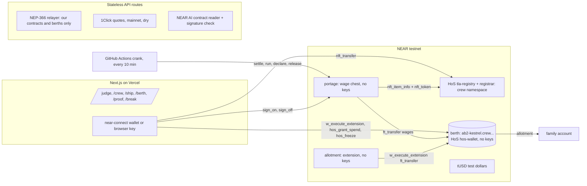

<p align="center"></p>
<h1 align="center">Berthright</h1>
<p align="center"><b>Four months of crew wages on board, without an insurance claim.</b></p>
<p align="center"><a href="https://berthright-app.vercel.app">Live app</a> · <a href="https://berthright-app.vercel.app/judge">For judges: 4-minute run</a> · Video (link added at submission) · <a href="https://berthright-app.vercel.app/proof">Proof from chain</a></p>
<p align="center"><a href="https://github.com/0xkinno/berthright/actions/workflows/ci.yml"></a> </p>

Each berth on a ship is a NEAR Top Level Account that is also an NFT. The shipowner must lock four
months of that berth's wages before anyone signs on. Wages flow into the berth every day. The
allotment home pays itself. If the shipowner stops paying, anyone can trigger the release of the
guarantee to each crew member's own account.

| | |
|---|---|
| Live | https://berthright-app.vercel.app, no login; judge wallets are created in your browser |
| For judges | `/judge`: a 4-minute walk whose checklist ticks itself from chain |
| Tracks | NFTs That Do Something (`nfts`), Real-World Money (`realworld`), Open Innovation (`open`) |
| Built on | House of Stake Top Level Accounts (`hos-wallet`, `tla-registry`), NEP-171, NEP-141, NEP-413, NEP-366, NEAR Intents 1Click, NEAR AI Cloud |
| Measured | 138 real abandonment cases replayed: 57.8% of owed crew-months would have been on board on day one (today: 0%) |

**Reality rung:** the full money loop runs on NEAR testnet against House of Stake's own audited
contracts, deployed unmodified. Intents quotes are live on mainnet (quote only). See
[Live, substituted, designed](#live-substituted-designed).

## Day 74 at anchor

**Arjun Nair** (fictional), 31, able seaman from Kochi. Day 74 at anchor off Khor Fakkan, UAE, 21:40
ship's time. His company has not paid wages for two months; under the Maritime Labour Convention
that already counts as abandonment. His sister's college fee is due on Friday. The insurer is meant
to cover up to four months of wages, but first he has to find out who the insurer is, file a claim
from a ship with patchy internet, and wait. One insurer took 8 months to accept liability.

Arjun is fictional. These are not:

| What is true | Source |
|---|---|
| 6,223 seafarers were abandoned on 410 ships in 2025, owed US$25.8M; the ITF recovered US$16.5M | [ITF, 2025 data](https://www.itfseafarers.org/en/news/seafarer-abandonment-crisis-thousands-left-behind-shippings-worst-year-record) |
| Indian seafarers were the most abandoned group, 1,125, two years running; the UAE had the second most abandoned vessels | same |
| Two months of unpaid wages is abandonment; the financial security covers up to four months plus repatriation | MLC 2006 as amended, Standard A2.5.2 paras 2(c) and 9 |
| An insurer took eight months to accept liability and pay | [ITF to IMO, LEG 105/4/3](https://www.itfglobal.org/sites/default/files/node/resources/files/2018%20LEG%20105-4-3%20-%20Implementation%20of%20the%20financial%20security%20requirement%20under%20MLC%2C%202006%2C%20as%20amended%2C%20for%20the...%20%28ITF%29.pdf) |

Full table with exact quotes: [docs/MOMENT.md](docs/MOMENT.md). I am training for STCW
certification; sea-service records and wage abandonment are the two things every seafarer I have
met talks about. No practitioner has reviewed this yet.

## What Berthright does

1. **Before anyone signs on**, the shipowner locks four months of the berth's wages and the fare
   home in the wage chest (`portage`). No reserve, no sign-on.
2. **Every day**, wages accrue by the second; anyone may settle them into the berth account. A
   scheduled job does it every ten minutes.
3. **The allotment home** goes through the berth's own spend grant: one receiver, one token, a
   budget, an expiry, enforced by House of Stake's audited wallet code.
4. **If the shipowner stops paying**, after a 14-day grace (MLC allows two months) anyone declares
   abandonment and releases each crew member's guarantee straight to their own account.
5. **At crew change**, the crew member signs off (final pay to their own account) and hands the berth
   NFT to the relief. The berth keeps its sea-service record.

**What the human does that software cannot:** signs on and off at the gangway, confirms the wage
from their own contract, chooses who gets the allotment, hands the berth over in person. After
sign-on Berthright asks for at most one decision a month. Always shown: abandonment declared,
guarantee released, berth frozen, hand-over requested.

## Try it in 4 minutes

1. Open [/judge](https://berthright-app.vercel.app/judge), press **Start the 4-minute run**. See three
   accounts created in your browser and a berth issued to your crew account.
2. Press **Do it** on each step. See a refused sign-on (`E_RESERVE_NOT_ON_BOARD`), a sign-on, wages
   in the berth, an allotment at the family account, an early declaration refused with seconds
   left, then the release to the crew member's own account.
3. Press the failure buttons. See each refusal on chain with its decoded code.
4. From a clean clone with no keys: `npm ci && npx tsx scripts/verify.ts` ends with
   `N of N checks pass`; `--tamper` fails.

## How it works



```mermaid
sequenceDiagram
  participant O as Shipowner
  participant P as portage
  participant B as berth (HoS leased name)
  participant R as tla-registry
  participant C as Crew member
  O->>P: create_ship, open_berth, fund (ft_transfer_call)
  C->>P: sign_on(berth, my wage, contract hash)
  P->>B: nft_item_info
  P->>R: nft_token
  P-->>P: refuse unless both name C, berth Active, wage matches, reserve on board
  loop every 10 minutes
    P->>B: settle: re-read rotation_seq, pay wages
  end
  Note over O,P: owner stops funding; arrears start; 14 ship days of grace
  C->>P: declare_abandonment, release_guarantee (anyone may)
  P->>C: four months + fare home, to C's own account
```

```
 berth plate: ab2-kestrel.crew.berthright.testnet
 +-- name     a real NEAR account, created by the crew namespace registrar
 +-- NFT      the same name is a token in the HoS registry; the holder is the crew member
 +-- no keys  zero access keys; only the holder acts, through w_execute_extension
 +-- lease    fixed term; HoS cannot move a live lease without the holder
 +-- grant    hos_grant_spend: the allotment fence (receivers, token budget, expiry)
 +-- record   portage.berth_history: who held it, when, what they earned and were paid
```

## The berth is the account

| TLA property | Its job in Berthright | Code |
|---|---|---|
| A name that is an account | The chest pays it; the family recognises it; the record attaches to it | HoS `registrar`; `portage.open_berth` checks `.{registrar}` |
| NEP-171 token | Crew change is a token transfer | HoS `tla-registry/src/nft.rs:127`; `app/lib/actions.ts` `handOver` |
| No access keys, owner acts through `w_execute_extension` | Nobody can bolt a key on; the shipowner never controls a berth | HoS `hos-wallet/src/lib.rs:251`; test `add_key_on_a_berth_is_impossible_and_house_of_stake_cannot_move_it_alone` |
| HoS cannot move a live lease alone | The company cannot seize a berth | HoS `apply_rotation` `needs_holder`; same test |
| Owner freeze | A stolen phone in port: freeze, wages keep arriving | HoS `hos_freeze`; test `a_frozen_berth_does_not_lose_wages` |
| Spend grant | The allotment home, fenced by audited code | HoS `hos_grant_spend`; test `allotment_pays_only_the_granted_receiver_up_to_the_budget` |
| Transfer wipes grants and extensions | The old holder's allotment dies at hand-over | HoS `hos-wallet/src/lib.rs:786,795`; test `tla_transfer_wipes_the_allotment_grant` |
| `nft_item_info` with `rotation_seq` | The chest detects an unannounced hand-over and pays the account that signed on | `portage.on_settle_checked`; test `an_unannounced_hand_over_pays_the_recorded_holder_and_never_the_berth` |
| Namespace issuer | A crew welfare trust (fictional) issues berths, never the shipowner | `fleet/deploy-testnet.ts` (payment authority bound to the namespace) |

## What it will not do

| Refusal | Code | Test |
|---|---|---|
| Sign-on before four months are on board | `E_RESERVE_NOT_ON_BOARD` | `sign_on_is_refused_until_four_months_are_on_board` |
| Sign-on at a different wage than the crew member's contract | `E_WAGE_DIFFERS_FROM_YOUR_CONTRACT` | `sign_on_is_refused_when_the_wage_differs_from_the_crew_members_contract` |
| A stranger signs on | `E_NOT_BERTH_HOLDER` | `a_non_holder_cannot_sign_on` |
| A ship promising less than four months | `E_RESERVE_BELOW_MLC` | `a_ship_cannot_promise_less_than_four_months` |
| The owner takes the reserve | `E_RESERVE_LOCKED` | `the_owner_cannot_withdraw_the_reserve` |
| Abandonment declared early | `E_NOT_YET_ABANDONED` | `abandonment_cannot_be_declared_before_the_grace_ends` |
| A guarantee released twice | `E_ALREADY_RELEASED` | `release_guarantee_pays_once` |
| Release paying more than is owed | by construction | `release_never_pays_more_than_is_owed` |
| The old holder's allotment after hand-over | `E_BERTH_CHANGED_HANDS` | `allotment_stops_after_hand_over` |
| Allotment to an ungranted receiver, or over budget | `RECEIVER_NOT_GRANTED`, `TOKEN_CAP_EXCEEDED` (HoS wallet) | `allotment_pays_only_the_granted_receiver_up_to_the_budget` |

Tests: 26 unit and property tests (`contracts/portage/src/tests.rs`, two properties at 10,000 cases
each) and 11 sandbox tests against the real HoS wasm (`contracts/portage/tests/`).

## What NEAR does here

House of Stake's Top Level Accounts are the product, not a backdrop: each berth is a leased name
running HoS's audited wallet, the NFT is HoS's registry, and the allotment is HoS's spend grant. We
call their contracts directly (there is no SDK yet) and deploy them unmodified from commit
`d85860a`. Full list: [docs/SDK_SURFACE.md](docs/SDK_SURFACE.md).

**Design note from reading their code.** When a leased name changes hands, native NEAR above the
storage reserve is swept to the seller's payout account, while NEP-141 token balances stay in the
account and pass to the buyer (unless the registry allowlists the token, in which case the transfer
is refused until the name is empty). Grants and extensions are wiped. So Berthright pays wages in a
token, signs off before every hand-over, and empties the berth in the same approval. Reproduced in
a sandbox: [docs/FINDINGS.md](docs/FINDINGS.md), [/findings](https://berthright-app.vercel.app/findings).

## Measured

- **Replay of real cases** (2023 to 2025, ITF public abandonment list retrieved 2026-11-13):
  138 cases replayed, 1,632 seafarers, 7 excluded for missing data.
  **57.8%** of owed crew-months would have been on board on the day abandonment began,
  against 0% today. 54 cases fully covered; 84 partial misses (more than four months
  owed), largest: FOURTHMAN (IMO 9181508): 18 months owed, 18 crew; SATURINA (IMO 6217726): 9 months owed, 35 crew; PRINCE 4 (IMO 8512865): 12 months owed, 21 crew. Every case: [data/replay.json](data/replay.json).
  Bias: the list shows open cases, which lean long. Across all listed years: 233 cases, 64.2%.
- **Break campaign, cost per wage day, unattended crank run:** recorded after the testnet
  deployment in [docs/EVIDENCE.md](docs/EVIDENCE.md).

## Judging criteria map

| Criterion | Where to look |
|---|---|
| Technical implementation | `contracts/portage` (exact accrual with carry, conservation property-tested), sandbox tests on the real HoS fleet, `scripts/verify.ts` |
| Design | `/` and `/crew` on a phone; [docs/DESIGN.md](docs/DESIGN.md) |
| Impact | the replay above; the portage bill a master already keeps (`/ship/<id>`, CSV and PDF) |
| Originality | the first product on HoS Top Level Accounts; the berth as an account that holds its own guarantee |
| Sustainability | keyless contracts, a permissionless crank, Vercel plus chain only, no server holding user keys |

## Live, substituted, designed

| Piece | State |
|---|---|
| Wage chest, allotment, tUSD | live on testnet, keyless, code hashes equal the reproducible build (EVIDENCE.md) |
| House of Stake TLA fleet | live on testnet: their code, unmodified, deployed by us under `berthright.testnet` (HoS's own mainnet fleet does not issue our crew namespace) |
| Test dollars | `tUSD`, a test token with a faucet; on mainnet a ship would use USDC |
| NEAR Intents | live mainnet 1Click quotes on a partner key, `dry: true`; no swap is executed |
| NEAR AI contract reader | live: Qwen3-VL in a TEE, reply signatures verified against the attested signer; injected and doctored contracts land in REVIEW |
| Relayer | built; live once a relayer key is configured |
| Mainnet leased name read | designed; shown on `/proof` when `NEXT_PUBLIC_MAINNET_SAMPLE_LEASED_NAME` is set |

## Risk

| Parameter | MLC 2006 | Berthright |
|---|---|---|
| Wage security | up to 4 months via an insurer claim | 4 months locked before sign-on |
| Abandonment trigger | 2 months unpaid | 14 ship days unpaid (max 30) |
| Who pays out | insurer, after a claim | the contract, to the crew member's own account |

Maximum loss for a crew member: wages beyond four months. Circle can freeze USDC on mainnet. Full
table: [docs/RISK.md](docs/RISK.md). Threat model for the hand-over: [docs/THREAT_MODEL.md](docs/THREAT_MODEL.md).

## Limits

- Testnet only for the money loop. No real wages have moved.
- A cross-contract read can be one or two blocks stale; a settle racing a hand-over could pay one
  settlement into the berth the relief now holds. The app signs off before every hand-over.
- The guarantee covers four months. Some real cases ran 18 months or more; those are partial misses.

## Disclosures

AI tools: built with Claude Code. Libraries: near-sdk, near-contract-standards, near-workspaces,
near-api-js, @hot-labs/near-connect, Next.js, React, Tailwind, motion, lenis, lucide-react,
proptest. House of Stake code is deployed unmodified from commit
`d85860a8cc2bfcb8b617b28cab558da5d39333fc` (MIT OR Apache-2.0). People, ships and companies in the
demo are fictional; demo ships run on a fast clock. All code was written from 13 Nov 2026, inside the
hackathon window. Other project led by Kinnoski in this hackathon (Q-015): to be confirmed by Kinnoski before submission.

## Run it

```bash
npm ci && npx tsx scripts/verify.ts
```

```bash
cargo test --profile proptest -p portage -p allotment -p tusd --lib
```

```bash
fleet/build-hos.sh && for c in tusd portage allotment; do (cd contracts/$c && cargo near build non-reproducible-wasm --locked --no-abi); done && cargo test -p portage --test tla_transfer --test allotment --test voyage
```

```bash
cd app && npm ci && npx next dev
```

Environment for the app: see `app/.env.example`.

## Repository map

```
contracts/portage     wage chest + unit, property and sandbox tests
contracts/allotment   HoS wallet extension that sends the allotment
contracts/tusd        test dollars
fleet/                build and deploy the HoS fleet unmodified
app/                  Next.js app and API routes
scripts/              census, replay, facts, verify, crank, seed-demo, checks
data/                 cases.csv, replay.json, sources.json
docs/                 MOMENT, THESIS, RISK, THREAT_MODEL, FINDINGS, FRICTION, SDK_SURFACE, EVIDENCE, ...
```

Licence: MIT. Links: [EVIDENCE](docs/EVIDENCE.md) · [PROOF](docs/PROOF.md) · [FINDINGS](docs/FINDINGS.md) · [THREAT_MODEL](docs/THREAT_MODEL.md) · [JUDGE](docs/JUDGE.md) · [PROGRESS](PROGRESS.md) · [MILESTONES](MILESTONES.md)
